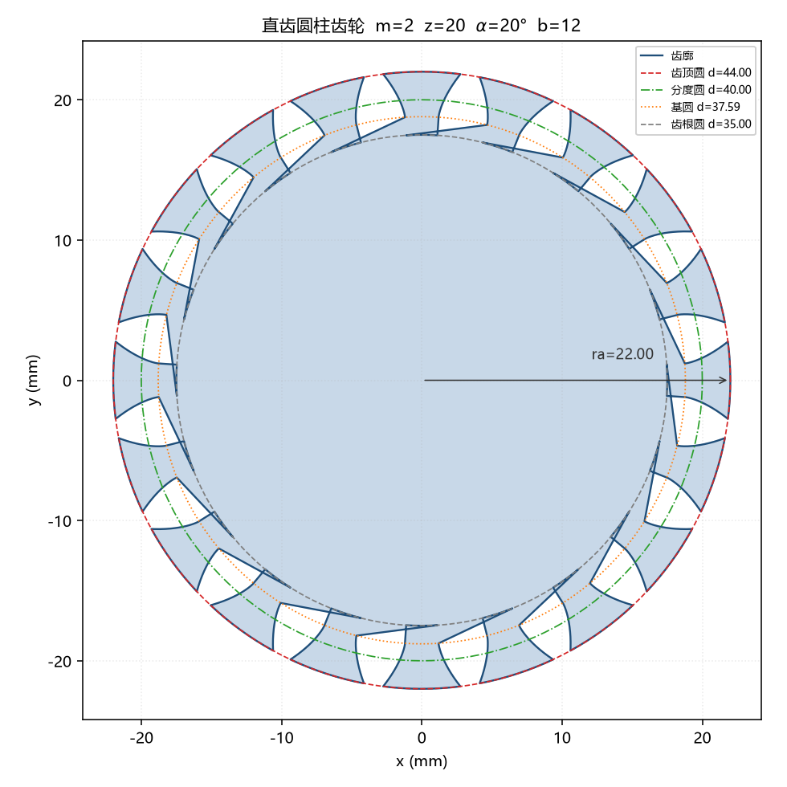
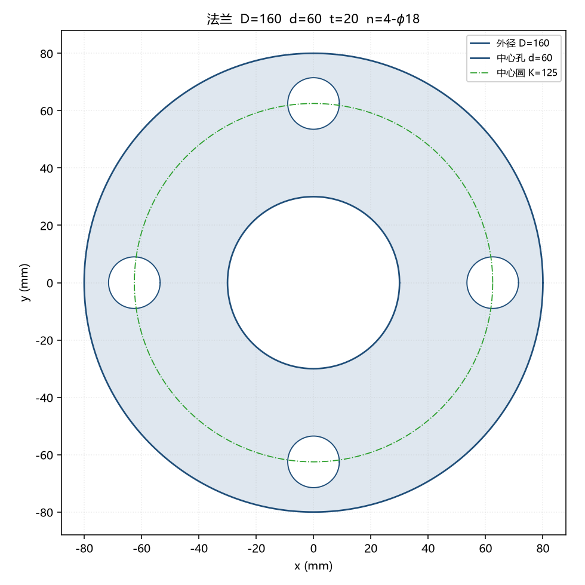

# mechparts

用代码描述机械零件，一键导出 **STEP / STL / DXF**。

面向机械专业学生：把《机械原理》里的公式变成可运行、可验证的代码，
生成的模型能直接用于课程设计、毕设、3D 打印和线切割下料。

```
        ┌─────────────────┐
        │  齿轮 / 法兰参数  │   m=2, z=20, α=20°
        └────────┬────────┘
                 ▼
        ┌─────────────────┐
        │   渐开线齿廓数学   │   纯 Python，可单元测试
        └────────┬────────┘
                 ▼
        ┌─────────────────┐
        │   STEP / STL    │   三维实体，可导入 SolidWorks
        │   DXF / PNG     │   二维下料图，可导入 AutoCAD
        └─────────────────┘
```

## 效果

| 直齿圆柱齿轮 (m=2, z=20) | 法兰 (D=160, n=4-φ18) |
|---|---|
|  |  |

## 安装

核心数学层**零依赖**，只有建模和绘图才需要额外库：

```bash
# 只要数学计算（尺寸表、齿廓点）
pip install -e .

# 要导出三维模型
pip install -e ".[cad]"

# 要出二维图纸
pip install -e ".[draw]"

# 全都要
pip install -e ".[all]"
```

## 快速开始

### 命令行

```bash
# 只打印尺寸表 —— 写课程设计说明书时直接抄
python -m mechparts gear -m 3 -z 25 --table

# 生成齿轮，导出 STEP + STL，带 15mm 中心孔
python -m mechparts gear -m 3 -z 25 -b 20 --bore 15 -o out/gear.step out/gear.stl

# 同时出 DXF 下料图和预览图
python -m mechparts gear -m 2 -z 20 -b 12 -o out/gear.step docs/gear.png docs/gear.dxf

# 法兰
python -m mechparts flange --od 200 --bore 80 -t 24 \
    --bolt-circle 160 --bolts 8 --bolt-hole 18 -o out/flange.step
```

尺寸表输出示例：

```
直齿圆柱齿轮  尺寸表 (m=3.0, z=25)
------------------------------------------
  模数 m                     3.0000
  齿数 z                         25
  压力角 alpha               20.0000
  分度圆直径 d                 75.0000
  基圆直径 db                 70.4769
  齿顶圆直径 da                81.0000
  齿根圆直径 df                67.5000
  齿顶高 ha                   3.0000
  齿根高 hf                   3.7500
  全齿高 h                    6.7500
  齿距 p                     9.4248
  分度圆齿厚 s                  4.7124
```

### Python API

```python
from mechparts import SpurGearGeometry, build_spur_gear, export

g = SpurGearGeometry(module=2.0, teeth=20, pressure_angle=20.0, face_width=10.0)

print(g.tip_diameter)   # 44.0  齿顶圆直径
print(g.summary())      # 完整尺寸表

part = build_spur_gear(g, bore_diameter=10.0)
export(part, "gear.step")
export(part, "gear.stl")
```

## 尺寸公式对照表

每个公式都能在《机械原理》教材里找到，代码里也标了出处：

| 参数 | 公式 | 说明 |
|---|---|---|
| 分度圆直径 | `d = m·z` | 基准圆 |
| 基圆直径 | `db = d·cos α` | 渐开线的发生圆 |
| 齿顶圆直径 | `da = d + 2m` | 齿顶高系数 ha\*=1 |
| 齿根圆直径 | `df = d − 2.5m` | 顶隙系数 c\*=0.25 |
| 全齿高 | `h = 2.25m` | ha + hf |
| 齿距 | `p = πm` | 相邻同侧齿廓弧长 |
| 分度圆齿厚 | `s = πm/2` | 齿厚 = 齿槽宽 |
| 渐开线函数 | `inv α = tan α − α` | 所有齿廓定位的基础 |
| 齿廓定位角 | `π/(2z) − inv α` | 见下方说明 |

**关于齿廓定位角**：渐开线在分度圆处的自然极角是 `inv α`，要让它落到
分度圆齿厚半角 `π/(2z)` 的位置，需要旋转 `π/(2z) − inv α`。
这个公式很容易写成加法（本项目第一版就写错了），结果是分度圆齿厚偏大、
齿轮无法正确啮合。测试 `test_tooth_thickness_equals_half_pitch` 专门守住这一点。

## 测试

```bash
python -m pytest -q
# 或者不装 pytest 直接跑
python tests/test_mechparts.py
```

当前 **15/15 通过**。核心验证不是"代码能跑"，而是**几何自洽**：

- **分度圆齿厚 = πm/2** —— 跨 7 组参数 (z=12…100, m=1…5) 误差 < 1e-3，齿轮啮合的最硬判据
- **法兰体积与解析解偏差 0.0** —— 手算 `π(R²−r²) − n·π·rh²` 与实体体积精确相等
- **齿廓落在齿根圆与齿顶圆之间**，且外轮廓逆时针（否则拉伸出的实体法向朝内）
- **齿顶跨度小于齿距角** —— 保证相邻齿不干涉
- **非法参数被拒绝** —— 孔切穿轮齿、螺栓孔超出外缘等情况抛出明确异常

## 项目结构

```
mechparts/
├── mechparts/
│   ├── gear_math.py      # 齿轮尺寸公式，纯数学零依赖
│   ├── gear_profile.py   # 渐开线齿廓离散化
│   ├── gear_solid.py     # 三维实体（build123d）
│   ├── flange.py         # 法兰
│   ├── drawings.py       # 二维图纸 / DXF / PNG
│   └── cli.py            # 命令行入口
├── tests/
├── examples/make_docs.py # 重新生成 README 里的图
└── docs/
```

分层的好处：`gear_math` 和 `gear_profile` 不依赖任何 CAD 库，
可以脱离 build123d 单独测试，也能在没装 CAD 的机器上跑。

## 已知限制

- 只支持**外啮合直齿圆柱齿轮**，尚未实现斜齿轮、内齿轮、变位齿轮
- 齿根采用圆弧过渡近似，不是标准**齿根过渡曲线**（不影响啮合，但疲劳强度分析不适用）
- 齿宽端面为直切，未做齿向修形
- 法兰默认值仅为量级参考，**实际使用请按 GB/T 9119 等标准查表**

## 后续计划

- [ ] 斜齿轮（螺旋角 β）
- [ ] 齿轮泵 / 带传动等常用机构
- [ ] 齿根过渡曲线精细化
- [ ] 一键生成带公差标注的二维工程图

## 许可证

MIT
